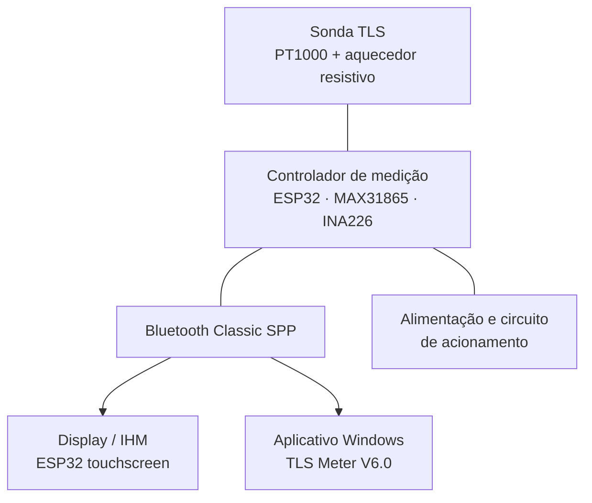

<div align="center">

# TLS METER
### Medidor portátil de resistividade térmica de solos e materiais de reaterro

**Aquisição de temperatura · Aquecimento controlado · Análise térmica · IHM touchscreen · Aplicativo Windows**

<p>
  
  
  
  
</p>

Desenvolvido no contexto do **Trabalho de Conclusão de Curso em Engenharia Elétrica** da  
**Universidade Federal de Campina Grande (UFCG)**, com atividades no **Laboratório de Alta Tensão (LAT)**.

[**Começar a usar**](#-como-executar-o-aplicativo-windows) · [**Estrutura do repositório**](#-estrutura-do-repositório) · [**Calibração**](#-calibração-com-a-amostra-padrão) · [**Manual**](#-manual-do-usuário)

</div>

---

## Sobre o projeto

O **TLS Meter** é um protótipo de instrumento destinado à determinação da **resistividade térmica** e da **condutividade térmica** de solos e materiais de reaterro, propriedades importantes para avaliar a dissipação de calor no entorno de **cabos elétricos subterrâneos**.

O equipamento utiliza o método da **fonte linear transiente** (*Transient Line Source* — TLS): uma sonda inserida no material recebe potência térmica controlada, enquanto o sistema registra a evolução de sua temperatura. Com os dados de temperatura, tempo e potência, o software identifica a região adequada para o ajuste e calcula as propriedades térmicas do material.

A **IEEE Std 442-2017** é utilizada como **referência metodológica** para o desenvolvimento e para os procedimentos de ensaio. Isso **não representa certificação IEEE** nem comprovação automática da exatidão metrológica do protótipo.

## ✨ Recursos do TLS Meter

| Área | Funcionalidades |
| :-- | :-- |
| **Medição** | Leitura de temperatura por PT1000 e MAX31865; monitoramento elétrico por INA226. |
| **Aquecimento** | Acionamento controlado do elemento resistivo e acompanhamento da potência aplicada. |
| **Segurança** | Autoteste de inicialização, verificação de sensores, monitoramento de bateria e interrupção do aquecimento em condições de falha. |
| **IHM portátil** | Operação por tela touchscreen, seleção de perfis de ensaio, acompanhamento, resultados e acesso ao histórico conforme os recursos habilitados. |
| **Windows** | Conexão Bluetooth, acompanhamento de gráficos e etapas, análise da região linear e exportação de resultados para Excel. |
| **Calibração** | Procedimento com Amostra Padrão, cálculo e confirmação de fator de correção para condutividade e resistividade. |

## ⚙️ Como o sistema está organizado



A **aquisição, o controle do aquecedor e as proteções críticas** permanecem no controlador de medição. A IHM e o Windows são interfaces alternativas de operação: **não devem tentar manter conexão Bluetooth simultânea com o mesmo medidor**.

### Versões presentes neste repositório

| Componente | Versão | Finalidade |
| :-- | :-- | :-- |
| Controlador de medição | **V1.3 — Bateria** | Aquisição, aquecimento, comunicação e proteções. |
| Display / IHM | **V2.0 — Calibração** | Operação local e menu de calibração. |
| Aplicativo Windows | **V6.0 — Calibração** | Interface desktop, gráficos, relatórios e calibração. |
| Manual do usuário | **V8** | Procedimentos de operação, ensaio e configuração. |

## 📁 Estrutura do repositório

```text
TLS Meter/
├── Firmwares/
│   ├── Controlador de Medição/
│   │   └── TLS_Meter_Firmware_Real_V1_3_Bateria/
│   │       └── ... código do controlador de medição
│   └── Display/
│       └── TLS_Meter_Display_V2_0_Calibracao/
│           ├── TLS_Meter_Display_V2_0_Calibracao.ino
│           └── tls_assets.h
│
├── Manual/
│   └── TLS_Meter_Manual_Usuario_V8.pdf
│
├── Windows app/
│   ├── release/
│   │   ├── TLS_Meter_V6.exe
│   │   ├── LEIAME.md
│   │   └── _internal/        ← bibliotecas e arquivos necessários ao EXE
│   └── Source/
│       ├── README.md
│       ├── tests/
│       │   └── test_calibration.py
│       └── Windows/
│           ├── tls_windows_app_v6_calibracao.py
│           ├── calibration_store.py
│           ├── requirements.txt
│           ├── TLS_Meter_V6.spec
│           ├── build_exe.bat
│           ├── iniciar_windows.bat
│           └── TLS_Meter_V6_Windows10.zip
│
└── README.md
```

> **Importante:** a pasta `Windows app/release/_internal/` contém as dependências da distribuição executável, incluindo bibliotecas `.dll`, `.pyd` e componentes do Python. **Não mova apenas o arquivo `.exe`**: para usar a versão distribuída, mantenha a estrutura da pasta `release`.

## 🖥️ Como executar o aplicativo Windows

O repositório contém uma distribuição executável do aplicativo Windows V6.0.

1. Baixe o repositório pelo botão **Code → Download ZIP** do GitHub e extraia os arquivos.
2. Abra a pasta [`Windows app/release/`](Windows%20app/release/).
3. Leia o arquivo [`LEIAME.md`](Windows%20app/release/LEIAME.md) para consultar as orientações específicas da distribuição.
4. Execute **`TLS_Meter_V6.exe`**, mantendo a pasta **`_internal`** no mesmo diretório.
5. Ative o Bluetooth no computador, faça o pareamento com o medidor quando necessário e libere a conexão na IHM por **Ajustes → PC**.
6. No aplicativo, utilize **Procurar e conectar** e confira o estado da comunicação antes de iniciar um ensaio.

A distribuição inclui os componentes necessários ao aplicativo, mas a compatibilidade depende da versão do Windows, do dispositivo Bluetooth e de suas configurações. Caso o sistema apresente um aviso de segurança, verifique a origem e a integridade dos arquivos antes de prosseguir.

**Para executar a partir do código-fonte**, consulte [`Windows app/Source/README.md`](Windows%20app/Source/README.md). O código principal está em [`tls_windows_app_v6_calibracao.py`](Windows%20app/Source/Windows/tls_windows_app_v6_calibracao.py), e os cálculos de calibração em [`calibration_store.py`](Windows%20app/Source/Windows/calibration_store.py).

## 📲 Operação pelo display (IHM)

A IHM permite realizar ensaios sem o computador, usando a tela sensível ao toque do equipamento.

**Fluxo básico de operação:**

```text
Ligar o medidor → Aguardar autoteste → Preparar a amostra
         → Selecionar perfil e parâmetros
         → Iniciar ensaio → Acompanhar o ciclo → Conferir o resultado
```

Para configurar a operação local, utilize o menu **Ajustes**. Para liberar a conexão para o aplicativo Windows, acesse **Ajustes → PC**.

O código da IHM está disponível em [`Firmwares/Display/TLS_Meter_Display_V2_0_Calibracao/`](Firmwares/Display/TLS_Meter_Display_V2_0_Calibracao/). Os arquivos `.ino` e `tls_assets.h` devem permanecer juntos no projeto Arduino.

O código do controlador de medição fica em [`Firmwares/Controlador de Medição/`](Firmwares/Controlador%20de%20Medi%C3%A7%C3%A3o/).

## 🧪 Calibração com a Amostra Padrão

A calibração utiliza um **corpo de prova de referência**, acompanhado de sua identificação e de um valor conhecido de condutividade térmica, para comparar o resultado medido pelo TLS Meter com a propriedade informada para a amostra.

Na IHM V2.0, o menu está em **Ajustes → Ensaio → Calibração**. No Windows V6.0, existe uma **aba Calibração** dedicada.

O fator proposto é calculado por:

$$
F_{\mathrm{cal}}=\frac{k_{\mathrm{ref}}}{k_{\mathrm{bruto}}}
$$

Após a confirmação do fator, os resultados passam a ser apresentados conforme:

$$
k_{\mathrm{corrigido}}=F_{\mathrm{cal}}\,k_{\mathrm{bruto}}
\qquad\text{e}\qquad
\rho_{\mathrm{corrigida}}=\frac{\rho_{\mathrm{bruta}}}{F_{\mathrm{cal}}}.
$$

O fator somente é adotado após **confirmação explícita**. As duas interfaces **armazenam seus fatores separadamente**, sem sincronização automática, e os valores brutos de medição são preservados.

> **Atenção:** o valor de referência deve corresponder à **Amostra Padrão efetivamente utilizada**, com suas condições de referência documentadas. Não utilize valores genéricos de tabelas de materiais como se fossem um valor certificado da peça. A implementação do software não substitui a **validação experimental do procedimento de calibração e da repetibilidade**.

## 📈 Princípio de cálculo

Na região em que a resposta térmica se aproxima de uma reta em função de `ln(t)`, considera-se:

$$
T(t)\approx a\,\ln(t)+b.
$$

Sendo `a` a inclinação do ajuste e `q` a potência por unidade de comprimento ativo da sonda, a resistividade térmica é estimada por:

$$
\rho=\frac{4\pi a}{q}
\qquad\text{e}\qquad
k=\frac{1}{\rho}.
$$

Essas relações são aplicadas sob as condições e limitações do método TLS. A qualidade do ajuste, a estabilidade da potência, a geometria da sonda, o contato térmico e as condições da amostra influenciam o resultado final.

## 📘 Manual do usuário

O manual reúne orientações de preparação das amostras, segurança, operação pela IHM, conexão com o computador, gráficos, resultados, calibração e cuidados com o equipamento.

**[📖 Abrir o Manual do TLS Meter — V8 (PDF)](Manual/TLS_Meter_Manual_Usuario_V8.pdf)**

> O manual é uma **versão preliminar de desenvolvimento**. Sua documentação e seus procedimentos poderão ser aprimorados conforme a evolução do protótipo, os resultados dos ensaios e os requisitos de uma eventual aplicação comercial.

## 🔬 Situação do desenvolvimento

O repositório disponibiliza os códigos das interfaces de medição e calibração, o aplicativo Windows em formato executável e o manual do usuário. A consolidação dos ensaios com material de referência, a avaliação de repetibilidade e a caracterização metrológica completa integram a continuidade da validação experimental.

**O TLS Meter é um protótipo acadêmico de pesquisa e desenvolvimento**, não um instrumento declarado como certificado ou pronto para uso comercial. Resultados destinados a decisões de engenharia exigem procedimento adequado e avaliação crítica da rastreabilidade e da incerteza da medição.

## 👨‍🎓 Desenvolvimento e créditos

**Francisco Olímpio Ferreira da Silva**  
Curso de **Engenharia Elétrica — UFCG**  
**Laboratório de Alta Tensão (LAT)**  
Orientação: **Prof. Ronimack Trajano de Souza**

Agradecimento à Universidade Federal de Campina Grande e ao Laboratório de Alta Tensão pelo apoio acadêmico e pela infraestrutura de desenvolvimento.

---

<div align="center">

**TLS METER** · Da aquisição térmica à interpretação dos resultados.

*Projeto acadêmico em desenvolvimento — UFCG / LAT*

</div>
